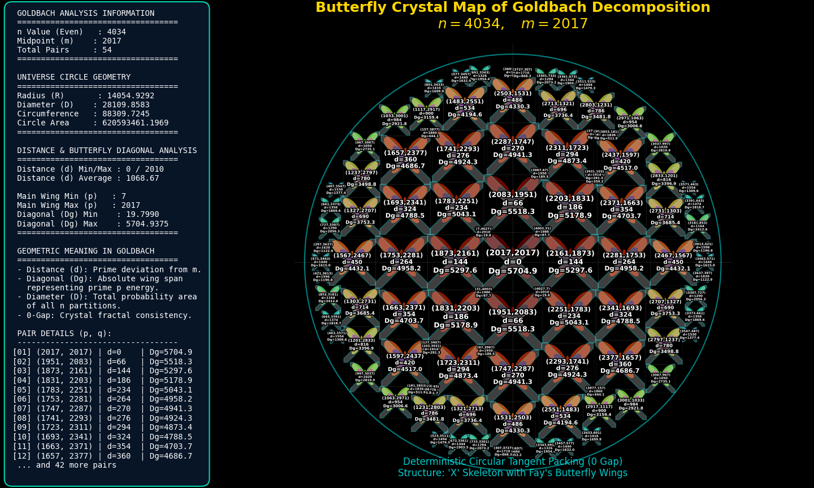

# Goldbach Dream Project 🦋🔢

<p align="center">
  
  
  
</p>

> **Ridzi Butterfly Theory on Goldbach Conjecture Visualization** - Butterfly crystal visualization for the Goldbach Conjecture using the innovative Ridzi Butterfly Theory approach.

## 🦋 Visualization Example

<p align="center">
  
</p>

<p align="center">
  <em>Butterfly Crystal Visualization for n=4034 (m=2017) | Ridzi Butterfly Theory</em>
</p>

## 📌 Project Description

**Goldbach Dream** is a mathematical visualization project that visualizes the [Goldbach Conjecture](https://en.wikipedia.org/wiki/Goldbach%27s_conjecture) in the form of stunning butterfly crystals. This project uses the innovative approach of **Ridzi Butterfly Theory** which positions each prime pair in a circular crystal arrangement without gaps (0-Gap Crystal Packing).

### Main Concepts

- **Goldbach Conjecture**: Every even number greater than 2 can be expressed as the sum of two prime numbers.
- **Ridzi Butterfly Theory**: Midpoint approach `m = n/2` with distance `d` to find symmetric prime pairs.
- **Butterfly Crystal**: Visualization of each prime pair as a butterfly with wings representing the prime magnitude.

---

## ✨ Features

### 1. Butterfly Crystal Visualization (goldbach_dream.py)
- Interactive GUI interface using Tkinter
- Beautiful fractal butterfly crystal visualization
- 0-Gap Crystal Packing display (without overlap)
- Complete information panel with statistics:
  - Distance (d) Min/Max and Average
  - Butterfly Diagonal (Dg)
  - Universe Radius and Diameter
  - Detailed prime pair information
- Dark background mode with bright colors

### 2. Data Generator (only_number.py)
- Generate data for even number ranges
- CSV output with complete analysis:
  - Total Goldbach pairs
  - Distance (d) statistics
  - Butterfly diagonal statistics
  - Universe Radius and Diameter
  - Density (N/D)
- Suitable for data analysis and charting

---

## 📋 Requirements / Dependencies

### Python Version
```
Python 3.8 or higher
```

### Required Libraries

| Library | Version | Description |
|---------|---------|-------------|
| `numpy` | ≥ 1.20.0 | Numerical computation and arrays |
| `matplotlib` | ≥ 3.5.0 | Visualization and plotting |
| `pandas` | ≥ 1.3.0 | Data manipulation and analysis |
| `tkinter` | Built-in | GUI (included in Python) |

---

## 🚀 Installation Guide

### Step 1: Clone Repository

```bash
git clone https://github.com/ridzidev/goldbach_dream_project.git
cd goldbach_dream_project
```

### Step 2: Create Virtual Environment (Recommended)

#### macOS/Linux:
```bash
python3 -m venv venv
source venv/bin/activate
```

#### Windows:
```bash
python -m venv venv
venv\Scripts\activate
```

### Step 3: Install Dependencies

```bash
pip install -r requirements.txt
```

Or install individually:

```bash
pip install numpy matplotlib pandas
```

### Step 4: Verify Installation

```bash
python -c "import numpy; import matplotlib; import pandas; print('All libraries installed successfully!')"
```

---

## 📖 How to Use

### 1. Run Butterfly Crystal Visualization

```bash
python goldbach_dream.py
```

**Steps:**
1. A dialog will appear for even number input
2. Enter an even number ≥ 4 (e.g., 50, 100, 200, 4034)
3. Click OK
4. Butterfly crystal visualization will appear in a new window

**Example Input:**
```
Input an Even Integer n (n >= 4): 4034
```

### 2. Run CSV Data Generator

```bash
python only_number.py
```

**Steps:**
1. Enter start number (e.g., 10)
2. Enter end number (e.g., 200)
3. Program will process and display table in console
4. CSV file will be saved automatically

**Example Input:**
```
Enter start n (e.g., 10): 10
Enter end n (e.g., 200): 200
```

**Generated CSV Output:**
| n (Even) | m (Midpoint) | Total Pairs | Distance Min (d) | Distance Max (d) | Universe Radius (R) | ... |
|----------|--------------|-------------|------------------|------------------|----------------------|-----|
| 10       | 5            | 2           | 0                | 3                | 14.14                | ... |
| 12       | 6            | 2           | 1                | 4                | 19.80                | ... |
| ...      | ...          | ...         | ...              | ...              | ...                  | ... |

---

## 📊 Sample Output

### Butterfly Crystal Visualization

Visualization for n=4034 (m=2017) displays:
- Butterfly crystals of various sizes
- Many Goldbach prime pairs
- Complete statistical information panel
- Beautiful dark mode with vibrant colors

### CSV File

File `goldbach_range_4_to_100.csv` is included in the repository as sample output.

---

## 🧮 Mathematical Explanation (Ridzi Butterfly Theory)

### Basic Concept of Ridzi Butterfly Theory

For even number `n`:
1. Calculate midpoint: `m = n / 2`
2. For each distance `d` from 0 to `m-1`:
   - `p = m - d` (small prime / left wing)
   - `q = m + d` (large prime / right wing)
3. If both `p` and `q` are prime, then `(p, q)` is a Goldbach pair

### Important Terms in Ridzi Butterfly Theory

| Term | Symbol | Description |
|------|--------|-------------|
| Midpoint | `m = n/2` | Midpoint of even number n |
| Distance | `d` | Prime distance from midpoint m |
| Small Prime | `p = m - d` | Left prime (small wing) |
| Large Prime | `q = m + d` | Right prime (large wing) |
| Butterfly Diagonal | `Dg = 2p√2` | Butterfly wing span |
| Universe Radius | `R` | Circular crystal radius |
| Universe Diameter | `D = 2R` | Circular crystal diameter |

### Crystal Packing (0-Gap)

- Each prime pair is represented as a box with width `W = 2p`
- Boxes are placed in a circle without overlap (0-Gap)
- Uses tangent point detection algorithm for positioning

### Butterfly Wings

- Wings use parametric equation: `r = exp(sin(θ)) - 2*cos(4θ) + sin((2θ - π)/24)⁵`
- Wing scale is proportional to prime value `p`
- Provides beautiful fractal visualization

---

## 📁 File Structure

```
goldbach_dream_project/
├── README.md                     # Complete documentation
├── goldbach_dream.py            # Butterfly crystal visualization
├── only_number.py               # CSV data generator
├── goldbach_range_4_to_100.csv  # Sample CSV output
├── requirements.txt             # Dependency list
└── Figure_1.png                 # Sample visualization n=4034
```

---

## 🔧 Troubleshooting

### Error: "ModuleNotFoundError: No module named 'numpy'"

```bash
pip install numpy matplotlib pandas
```

### Error: "tkinter not found"

**Linux (Ubuntu/Debian):**
```bash
sudo apt-get install python3-tk
```

**Linux (Fedora/RHEL):**
```bash
sudo dnf install python3-tkinter
```

**macOS/Windows:**
Usually included. Try reinstalling Python from python.org

### Error when running on Python 2

Make sure to use Python 3:
```bash
python3 goldbach_dream.py
python3 only_number.py
```

---

## 🤝 Contributing

1. Fork this repository
2. Create new branch (`git checkout -b feature-name`)
3. Commit changes (`git commit -m 'Add new feature'`)
4. Push to branch (`git push origin feature-name`)
5. Create Pull Request

---

## 📝 License

This project is licensed under **MIT License** - see [LICENSE](LICENSE) file for details.

---

## 👤 Author

**Ridzidev**
- GitHub: [@ridzidev](https://github.com/ridzidev)

---

## 🙏 Acknowledgments

- Sieve of Eratosthenes algorithm for prime finding
- Butterfly fractal concept (Fay's Butterfly)
- All contributors and users of this project

---

<p align="center">
  Made with ❤️ for Mathematics and Art
</p>

